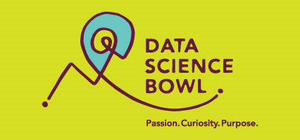
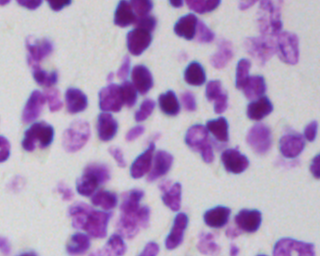
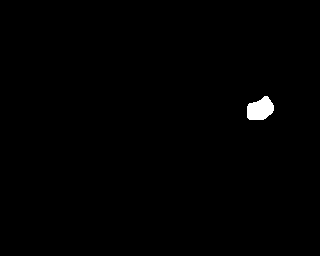

This year our team competed in the 2018 Kaggle Data Science Bowl. The goal of
the competition was to identify cells in microscopic images. There can be zero,
one or many cells in any given image. Our solution was a Convolutional Neural
Network with skip connections.

We used Google [Colab](https://colab.research.google.com/) which is a free
Jupyter notebook-like environment with a GPU. It offers realtime collaboration
similar to google docs and google sheets. The
[Overview of Colaboratory Features](https://colab.research.google.com/notebooks/basic_features_overview.ipynb)
is a good resource to learn this tool as well as the example notebooks.

The dataset provided consisted of png images and masks.

stage1_train
├── 00071198d059ba7f5914a526d124d28e6d010c92466da21d4a04cd5413362552
│   ├── images
│   │   └── 00071198d059ba7f5914a526d124d28e6d010c92466da21d4a04cd5413362552.png
│   └── masks
│       ├── f6eee5c69f54807923de1ceb1097fc3aa902a6b20d846f111e806988a4269ed0.png
│       ├── ffae764df84788e8047c0942f55676c9663209f65da943814c6b3aca78d8e7f7.png
│       ...
├── 003cee89357d9fe13516167fd67b609a164651b21934585648c740d2c3d86dc1
│   ├── images
│   │   └── 003cee89357d9fe13516167fd67b609a164651b21934585648c740d2c3d86dc1.png
│   └── masks
│       ├── 23947be0224e633947e9a3935d8ecf89be3eb56f68f30db85c74d4bf07d3028b.png
│       ├── 2a709842ce867d9b27281f9d8bec4968b88805afdff3de2ed0c8156f711483cd.png
│       ...
...


Each training example would be provided as a directory containing the image as
captured from the device.

And a set of masks showing where a cell was identified by an expert. For every
training example you would be provided between 1 and ~300 masks.

The submission criteria required us to
[Run Length Encode](https://en.wikipedia.org/wiki/Run-length_encoding)
the model's predictions. It is a technique that can communicate large runs of
information more efficiently than jpeg.

The approach we used was the same one as the winner of the ISBI cell tracking
challenge 2015:
[The U-net architecture](https://arxiv.org/pdf/1505.04597.pdf). It uses skip
connections similar to LSTMs to keep track of 'context' in 2 dimensions. This
context improves the performance of the model because it can better reason
about the textures it is currently looking at while considering if it is
looking at the inside of a cell or looking at a non-cell region of space.

To learn more about skip connections in NNs see 
[Deep Learning Section 10.9.1](http://www.deeplearningbook.org/contents/rnn.html)
and
[Understanding LSTM Networks](https://colah.github.io/posts/2015-08-Understanding-LSTMs/).

The U-net paper mentions Upsampling. This is the same as the term
"Deconvolution" used in other Deep Learning literature. Deconvolution can be
done in many ways. The method that ships with Keras is the
[Conv2DTranspose](https://keras.io/layers/convolutional/#conv2dtranspose).

Throughout the competition we learned the loss function is critical to the
performance of the network. It may sound obvious but careful selection of an
appropriate loss function will change the way the model behaves. For example,
we engineered the loss function to segment cells better by giving larger
penalty for misclassifying the cell boundaries. This worked because many cell
images have cells overlapping and touching. Early versions of the model would
have trouble learning the boundaries between cells. These boundaries should
have been labeled as not being a cell, but would incorrectly be classified as a
cell.

We experimented with removing padding. The accuracy of the model went down.
We believe this is because traditionally padding is used make the model give
consideration to the pixels near the border of the image. This means that the
border of the images have information that is useful for prediction.

Jacob compiled separate notes on
[Convolutional NNs](https://colab.research.google.com/drive/1H_CCNqv5z8P5bRD8uqMxg4LmwQiOLwMH).

Our work is visible at
[N.Y.C. Kaggle DS Bowl Colab](https://colab.research.google.com/drive/1UuUte6WA0vzUdfTe0CdvSpCcuELZxx9i),
[github](https://github.com/morenoh149/DATA-SCIENCE-BOWL-2018) and our
[google drive](https://drive.google.com/drive/u/0/folders/1eeCmqB1u7SL06R7kF3yKR7zABjUPrqqx).

Congratulations to this years
[winning kernel](https://datasciencebowl.com/2018tutorialwinners/).

And thank you to teammates
[Taraqur Rahman](https://www.linkedin.com/in/tqrahman/),
[Jacob Peters](https://www.linkedin.com/in/jacobdpeters/) and
[Cal Almodovar](https://www.linkedin.com/in/cal-orlando-almodovar-41b01258/).
