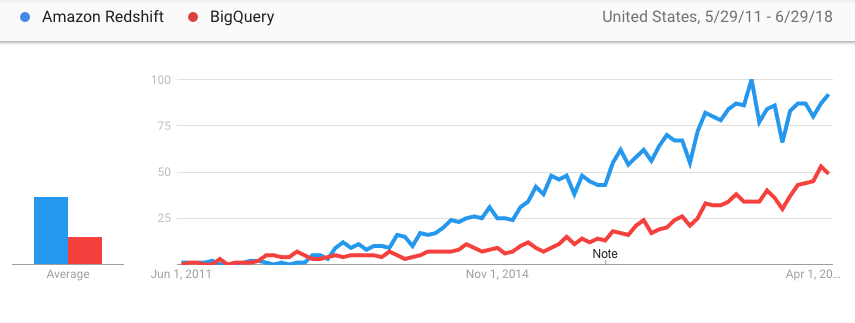
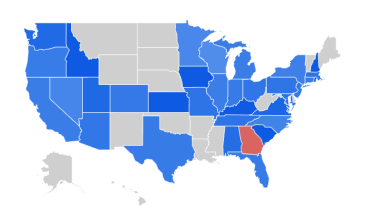
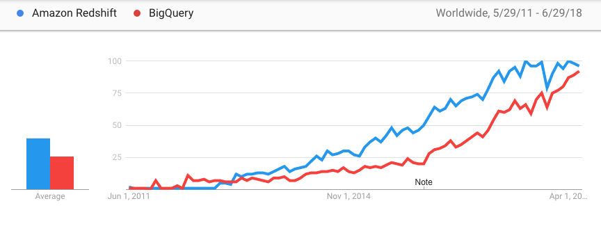
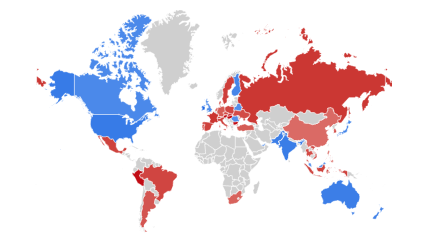

Big data analytics tools are a constantly shifting landscape. Most organization want to be data driven,
this means collecting your data into a data warehouse where it can be explored. The two biggest solutions
in the space are AWS Redshift and Google BigQuery. Here is what your big data administrator needs to
know to choose a solution.

## Architecture
Both of these solutions are focused on OLAP (Online Analytical Processing) workloads. These are usually
column stores. They are designed for fast analytics, not transactions like your product's main API.

Redshift was launched October 2012. It runs a
[forked version](https://docs.aws.amazon.com/redshift/latest/dg/c_redshift-and-postgres-sql.html)
of
[PostgreSQL](https://www.postgresql.org/) 8.0.2. It's changed under the hood to perform better on analytical
workloads and is missing some postgres 9.0 features. Redshift's mental model is that of managing a cluster
of nodes. You need to choose the number of CPUs and storage for your needs.

BigQuery was launched May 2010. It is a productionized version of an internal Google Database called
[Dremel](https://cloud.google.com/files/BigQueryTechnicalWP.pdf). There is no concept of hardware, you create
tables, upload your data and analyze it.

You trade speed for flexibility.

In Redshift you are given control over how to tune your big data database. You'll want a dedicated
person to tweak the data model and fine tune the cluster for the best performance and lowest infrastructure
cost. The payoff is that frequently queried data becomes cheaper to analyze, this results in lower cost of
generating reports and analysis.

BigQuery is much simpler. Use it if you are not sure what your analytical data model should look like or you
have lots of data that is rarely queried. BigQuery could be more appropriate if you don't project needing a
large analytical team in your organization, or can't afford to dedicate resources to build world-class
analytics.
If you are a Data Scientist working with a new dataset, you could build a prototype faster with BigQuery.
Similarly if your organization isn't a technology company, or you only have medium data, BigQuery will
be easier to get started with.

## BI tools
As the most popular datawarehouses in the space, both solutions have a mature ecosystem of
Business Intelligence tools. Note before using any BI tool, you'll want to build an ETL pipeline that copies the
production data into the datawarehouse. One exception is if your building a prototype for a stakeholder
and it's main backend is a datawarehouse. BI tools should also be sandboxed with read-only user, this way
your analysts cannot damage your data and are free to experiment.

[Metabase](https://metabase.com/) - free open source BI tool. Popular with startups as you can install
it in a VM for a BI solution.

[Looker](https://looker.com/) - paid product. Uses proprietary SQL extension
[LookML](https://www.youtube.com/watch?v=tBlGzp7ewVI) for enhancing your SQL queries.

[Tableau](https://www.tableau.com/) - enterprise BI solution. Here's a
[demo of it's UI](https://10az.online.tableau.com/#/site/demodepot/views/Sales-ExecutiveSalesforce/SalesSummary/showcaseuser@showcasecompany.com/MOLPremium?:iid=1).

[Google Analytics 360](https://www.google.com/analytics/360-suite) - enterprise
version of Google Analytics. You used to have to have google cloud costs in excess of
[$150,000/year](https://www.blastam.com/google-analytics-360-standard-comparison), with Google Analytics
360 you no longer have this requirement.

One of the advantages of Redshift was that it runs a full SQL engine. Meaning all SQL tooling works out of
the box on Redshift. Whereas BigQuery runs a SQL-like language that may have it's incompatibilities. This could
explain Redshift's dominance in the space. These days most BI tools support BigQuery,
so this consideration is not relevant anymore.

## Trends

[Google Trends](https://trends.google.com/trends/explore?date=2011-05-29%202018-06-29&q=%2Fm%2F0w30h97,%2Fm%2F0g5s7gf)
show that Redshift is more popular than BigQuery in the United States. It seems that data is viewed
as an area to invest in for many organizations. As such they are okay investing into developing
their datawarehouse and having fulltime engineers work on this problem if it gives them
a competitive advantage. The fact that BigQuery uses a SQL language that has incompatibilities
with standard SQL may explain why Redshift was able to overtake BigQuery despite it's 2 year headstart.
Investing in something that is nonstandard is viewed as more risky for an organization.

We see most search volume from the big tech hubs, Washington, California, New York. Interestingly in Georgia
more people are searching for BigQuery.

Worldwide, interest in BigQuery was overtaken by Redshift and in recent years the gap has been closing.

It seems like Redshift is more popular in developed countries. BigQuery is more popular in developing
countries.

## Conclusion
Datawarehous technologies are a big decision for organizations. Leveraging your data effectively can
be a competitive advantage. It's not always clear for stakeholders how much to invest. I hope this
post helps your big data administrator decide which tool is right for you.

If you need help assessing your existing software strategy or plan out a new project you can
[contact me](http://harrymoreno.com/about.html) here.
