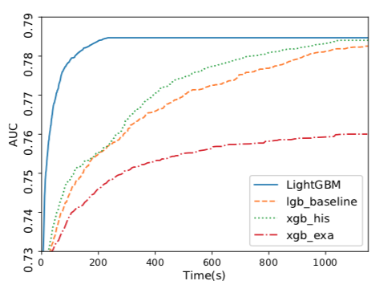

Gradient boosting decision trees is the state of the art for structured data problems.
Two modern algorithms that make gradient boosted tree models are XGBoost and LightGBM.
In this article I'll summarize their introductory papers for each algorithm's approach.

Gradient Boosting Decision Trees (GBDT) are currently the best techniques for building
predictive models from structured data. Unlike models for analyzing images (for that
you want to use a [deep learning](https://redirect.viglink.com?key=eda932df933d05f5b83e261bd5a77a46&u=https%3A%2F%2Fwww.amazon.co.uk%2FDeep-Learning-Adaptive-Computation-Machine%2Fdp%2F0262035618%2Fref%3Dsr_1_1%3Fie%3DUTF8%26qid%3D1523226978%26sr%3D8-1%26keywords%3Dbengio%2Bdeep%2Blearning&type=TO) model),
structured data problems can be solved very well with a lot of decision trees.
The best decision tree packages can train on large datasets with sublinear time
complexity, parallel over many cpus, distributed amongst a cluster of computers
and can extract most of the information from a dataset under a minute.

GBDTs train a basic model on the data and then use the first model's error as a
feature to build successive models. This process sequentially reduces the model's
error because each successive model improves against the previous model's weaknesses.
Each newly trained tree model attempts to linearly separate the remaining,
hard to separate, space. For a thorough treatment of boosting checkout
[MIT's 6-034](https://www.youtube.com/watch?v=UHBmv7qCey4).

[XGBoost](https://arxiv.org/abs/1603.02754) from the university of washington
and published in 2016 introduces two techniques to improve performance. Firstly
the idea of Weighted Quantile Sketch, which is an approximation algorithm for
determining how to make splits in a decision tree (candidate splits). The second
is Sparsity-aware split finding which works on sparse data, data with many missing
cells.

Weighted Quantile Sketch is a problem in boosting that is intractable for large
datasets. A fundamental idea in boosting is to augment the data where earlier
models make mistakes on. So in boosting we are interested in finding split points
in the weighted samples that perform the best. The authors of the XGBoost paper
explain their solution, a data structure that supports merge and prune operations
in a [supplementary paper](https://homes.cs.washington.edu/~tqchen/pdf/xgboost-supp.pdf).

Sparsity-aware Split finding introduces a default direction in each tree node.
When a value is missing in the sparse column the sample is classified into this
default direction. The default directions are learned from the data. Having a
default direction allows the algorithm to skip samples that are missing an entry
for the feature. This technique takes advantage of the sparsity in the dataset,
reducing the computation to a linear search on only the non-missing entries.

[LightGBM](https://papers.nips.cc/paper/6907-lightgbm-a-highly-efficient-gradient-boosting-decision-tree)
from Microsoft and published in 2017 also introduces two techniques to improve
performance. Gradient-based One-Side Sampling which inspects the most informative
samples while skipping the less informative samples. And Exclusive Feature
Bundling which takes advantage of sparse datasets by grouping features in a
near lossless way.

Gradient-based One-Side Sampling is a shortcut to extract the most information
from the dataset as fast as possible. This is achieved by adding a hyper parameter,
alpha (and an inverse beta which is 1-alpha). Alpha is the ratio of the samples
to retain as the most informative samples. The remaining samples are duplicated
so the complexity of the algorithm is reduced to a linear search over alpha samples.
The duplication of the less informative samples helps maintain the original data
distribution.

Exclusive Feature Bundling (EFB) combines similar columns. Whereas XGBoost's
Sparsity-aware split finding skips samples with empty values, reducing complexity
row-wise, EFB bins similar features, reducing complexity column-wise. The particulars
are unclear to me as I haven't studied the histogram-based algorithm used under
the hood. The authors claim, by a carefully designed feature scanning algorithm,
we can build the same feature histograms from the feature bundles as those from
individual features.

The LightGBM paper goes on to show experimentally that it trains in a fraction
of the time as XGBoost with comparable accuracy. Moreover there are datasets
for which XGBoost cannot run on as the data cannot fit into working memory.
LightGBM does not have to store as much working memory. Both papers mention the
advantages of data compression and cache hits.

In summary, LightGBM improves on XGBoost. The LightGBM paper uses XGBoost as a
baseline and outperforms it in training speed and the dataset sizes it can handle.
The accuracies are comparable. LightGBM in some cases reaches it's top accuracy
in under a minute and while only reading a fraction of the whole dataset. This
goes to show the power of approximation algorithms and intelligently sampling
a dataset to extract the most information as fast as possible.

*update:* After publishing this article some folks brought [Catboost](https://catboost.ai)
to my attention. Catboost improves over LightGBM by handling categorical features
better. Traditionally categorical features are one-hot-encoded, this incurs the
curse of dimensionality if the feature has many distinct values. Previous algorithms
tackled this issue of sparse features as we saw with EFB above. Catboost deals
with categorical features by, "generating random permutations of the dataset and
for each sample computing the average label value
for the sample with the same category value placed before the given one in the
permutation". They also process the data with GPU acceleration, and do feature
discretization into a fixed number of bins (128 and 32). I'm looking forward
to trying it out soon!

If you need help analyzing data or know anyone that does please
[contact me](https://harrymoreno.com/about.html). I'm always looking for interesting
work and to help stakeholders gain insights into their data.
