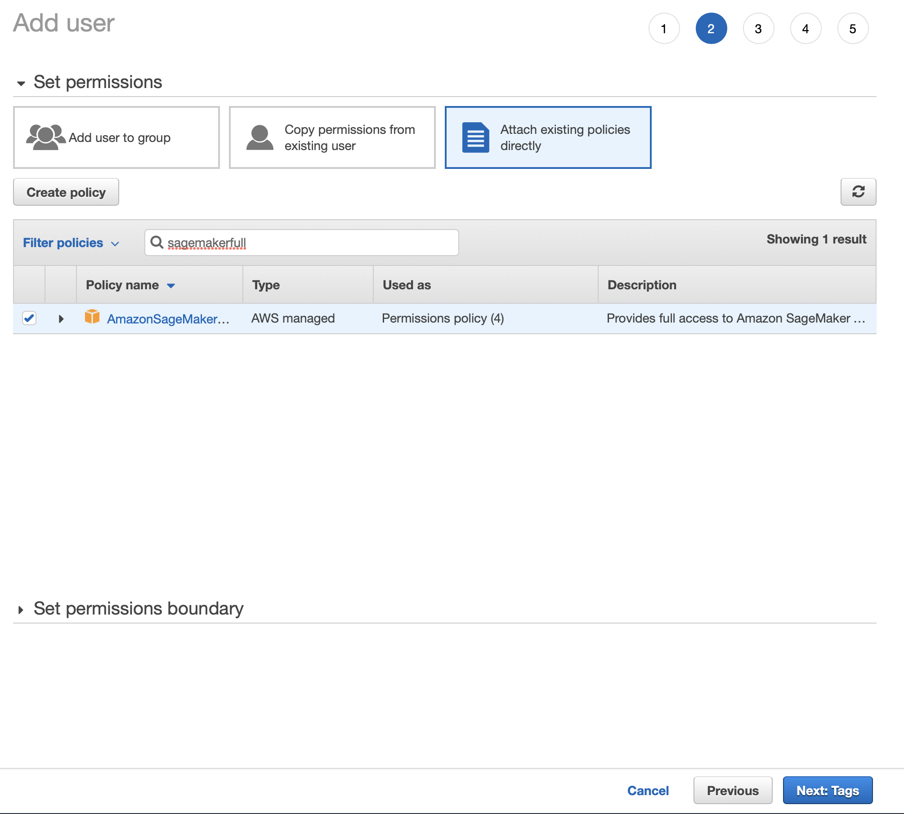
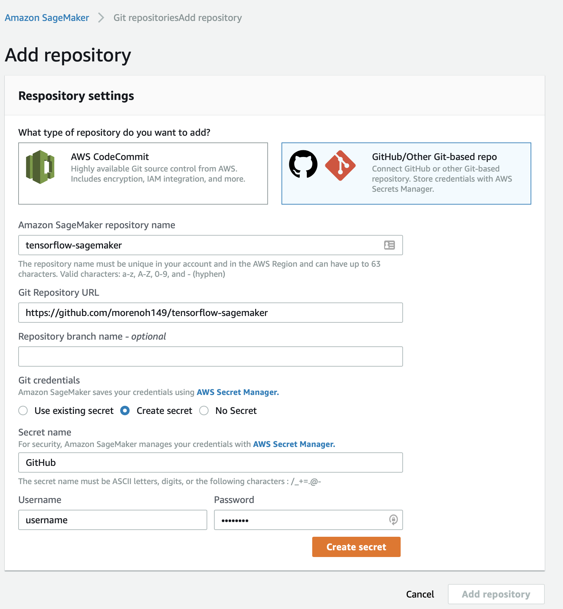
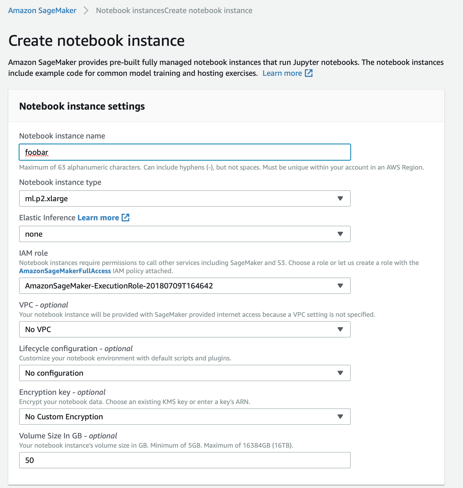
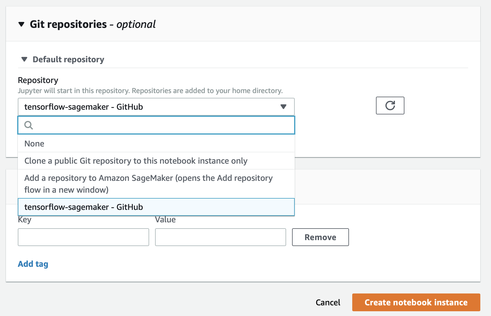
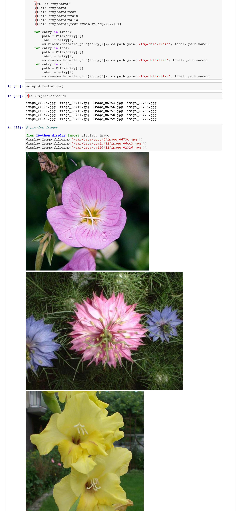
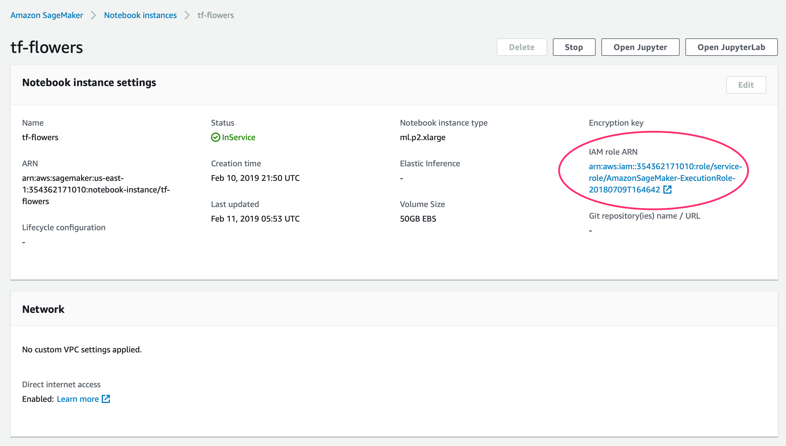

There are lots of materials on how to train neural networks but not as many
showing how to deploy them to power real services. In this post I'll share a
minimal example of how I train tensorflow models and deploy them on Sagemaker.
I'll cover items that I found intimidating so hopefully they become less
intimidating to you.

The code is available on [github](https://github.com/morenoh149/tensorflow-sagemaker).

Tensorflow is a deep learning framework from google. It is a skill that is in
demand from employers. One of the best resources for learning it is
[Hands-On ML with Scikit-learn & Tensorflow](https://www.amazon.com/gp/product/1491962291/ref=as_li_tl?ie=UTF8&camp=1789&creative=9325&creativeASIN=1491962291&linkCode=as2&tag=harryswebsite-20&linkId=dc3aa5aed4419619a91e199c7a8c5894).
If you have heard of Keras, it was folded into Tensorflow and the two are now
the same thing.

[Amazon Sagemaker](https://aws.amazon.com/sagemaker/) is a full-lifecycle
Machine Learning suite. You may have heard that ML is a multistep process. You
collect data, clean data, train on data, deploy data, collect more data and
retrain your models. Sagemaker has hosted gpu-enabled ipython notebooks where
you can do your data exploration and model training. Sagemaker also allows you
to programmatically launch large training jobs, perform hyperparameter
optimization and deploy your models to production.

Costwise Sagemaker is comparable to other cloud providers. The cheapest gpu enabled
instance is the `ml.p2.xlarge` ($1.26/hour). The cheapest deploy node is the
`ml.t2.medium` ($47/month). Our dataset is from the [Registry of Open Data on
AWS](https://registry.opendata.aws) which we can use for free as long as we only
transfer data within aws.

You should use [IAM](https://aws.amazon.com/iam/) to provision accounts with
restricted permissions. This is what you'd be expected to do in a work
environment so it's best to become familiar with the process. You can choose
the `AmazonSageMakerFullAccess` policy to grant the permissions needed for this
tutorial.

Optionally, you can configure your user to pull items from github.
You need to give your user your github password so it can fetch items
directly from github. You can do this inside sagemaker under `Notebook > Git repositiories`.
Add a repository and pass in the info. You can use the repo I shared.

Start a Notebook. Pick a gpu enabled instance type (for example `ml.p2.xlarge`).
Crank up the diskspace (I used 50 GB). And pick a github repo if you want.

Run the
[Explore and Train](https://github.com/morenoh149/tensorflow-sagemaker/blob/master/Explore%20and%20Train.ipynb)
notebook. This notebook loads the
[oxford 102 flowers](http://www.robots.ox.ac.uk/~vgg/data/flowers/102/)
dataset, trains a CNN using transfer learning and saves the model to disk.

If you get any issues when downloading the dataset from the s3 bucket check
your permissions. I struggled with this. It turns out that there are user
permissions (IAM) but also notebook permissions. You can doublecheck these by
selecting the notebook and reviewing the `IAM role ARN`.

Once you have a custom trained model you can deploy with Sagemaker. Run the
[Serving container flower model](https://github.com/morenoh149/tensorflow-sagemaker/blob/master/serving_container_flower_model.ipynb)
notebook. This notebook loads the model from disk, formats the model for
serving, uploads the formatted model to S3, deploys the model and tests the
model by making some predictions.

If everything runs correctly you should have a new entry in `Inference >
Endpoints`. This an api endpoint you could
[send an http request](https://docs.aws.amazon.com/sagemaker/latest/dg/API_runtime_InvokeEndpoint.html)
to using any of the sdks (python, ruby, php, javascript, etc). This model expects
pictures to be 226x226 pixels, so your client must perform image resizing before
querying the endpoint. You could retrain the model to use larger images.
Creating the client requests and changing the model image size are
left as exercises for the reader.

Finally remember to shutdown your notebooks and endpoints to avoid
a large aws bill! 💸
