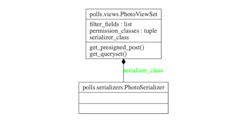

Here's a small tip on how to write some endpoints in Django Rest Framework. DRF
is a very powerful framework for building APIs. It provides the typical actions
(Create, Read, Update, Destroy) for your models. But what if
you want to change the default behavior?

Lets say your api has photo data. Such an endpoint would be implemented in DRF
like this:

from rest_framework import viewsets

class PhotoViewSet(viewsets.ModelViewSet):
    serializer_class = PhotoSerializer

This is powerful and fast to set up. However returning all the photos in a
service might raise some privacy concerns. How can we return an empty response
at the list endpoint instead?

We can study the sourcecode for the viewsets. [ModelViewSet#list](http://www.cdrf.co/3.9/rest_framework.viewsets/ModelViewSet.html#list) docs. A safe way to approach
overriding code is to first paste in the original implementation.

from rest_framework import viewsets

class PhotoViewSet(viewsets.ModelViewSet):
    serializer_class = PhotoSerializer

    def list(self, request, *args, **kwargs):
        queryset = self.filter_queryset(self.get_queryset())

        page = self.paginate_queryset(queryset)
        if page is not None:
            serializer = self.get_serializer(page, many=True)
            return self.get_paginated_response(serializer.data)

        serializer = self.get_serializer(queryset, many=True)
        return Response(serializer.data)

verify you haven't made any regressions.

Then we can decide on how to secure
the endpoint. You may decide to require a query param, if no query param is
provided return an empty response.


from rest_framework import viewsets

class PhotoViewSet(viewsets.ModelViewSet):
    serializer_class = PhotoSerializer

    def list(self, request, *args, **kwargs):
        user_id = self.request.query_params.get("user_id", None)
        if user_id is None:       
            queryset = Photo.objects.none()     
        else:                                  
            queryset = Photo.objects.all()    

        page = self.paginate_queryset(queryset)
        if page is not None:
            serializer = self.get_serializer(page, many=True)
            return self.get_paginated_response(serializer.data)

        serializer = self.get_serializer(queryset, many=True)
        return Response(serializer.data)

Here we intercepted the value of `queryset` and changed its value
based off of the query param.

This works. However we ran into issues later when we wanted to enforce similar
constraints on other endpoints. We later refactored the endpoint to only
override the `get_queryset` method:

class PhotoViewSet(viewsets.ModelViewSet):
    serializer_class = PhotoSerializer

    def get_queryset(self):
        user_id = self.request.query_params.get("user_id", None)
        if user_id is None:
            queryset = Photo.objects.none()
        else:
            queryset = Photo.objects.filter(user=user_id)
        return queryset


By the way, to generate the diagram in the header install [pylint](https://www.pylint.org) for python3. Then `pyreverse -ASmy -o png your_file.py`
