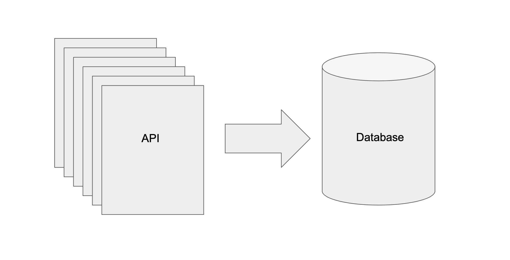

Async tasks are an intermediate backend engineering problem. Most public facing
apis need to return an answer under 1 second for a good user experience. However
many real world tasks require more than 1 second to complete or need to be scheduled
to repeat. The solution is usually to create a task that can run asynchronously.
In [Django](https://www.djangoproject.com) one way to accomplish this is by writing a management command.

Real APIs are typically paginated. Pagination means that only a portion of the matching
data is sent back at a time. Sending all of the results without pagination could
overwhelm the requesting program and bog down the service returning the
data. Since most real-world apis are paginated, learning how to traverse and consume
pagination is a good thing to master.

The following is an example of a django management command that queries a blog api,
traverses pagination to get all of the posts, processes and stores the data
in the database.


# app/management/commands/import_articles.py
import json, logging, os, traceback
from datetime import datetime, timedelta

import requests

from django.core.management.base import BaseCommand
from django.contrib.auth import get_user_model
from django.db.utils import IntegrityError

from app.models import Photo, Post

class Command(BaseCommand):
    """
    Usage:
    $ python manage.py import_articles
    $ python manage.py import_articles --begin_date 2019-09-09T09:30:00 --end_date 2019-09-10T09:30:00  
    """
    help = 'Import articles from 3rd party api.'

    def add_arguments(self, parser):
        parser.add_argument('--begin_date', action='store', default=None, help='beginning of data to import')
        parser.add_argument('--end_date', action='store', default=None, help='end of data to import')

    def handle(self, *args, **options):
        logger = logging.getLogger('app.management.commands')
        API_KEY = os.environ.get("API_KEY", "token")
        base_url='https://www.blog.com/v3/data/search'

        # process args if provided, otherwise set default values
        if options['begin_date']:
            begin_date = datetime.fromisoformat(options['begin_date'])
        else:
            begin_date = datetime.now() + timedelta(days=7)
        if options['end_date']:
            end_date = datetime.fromisoformat(options['end_date'])
        else:
            end_date = begin_date + timedelta(days=7)

        # api request params to be used
        payload={
            'token': API_KEY,
            'start_date.range_start': begin_date.isoformat(timespec='seconds'),
            'start_date.range_end': end_date.isoformat(timespec='seconds')
        }
        session = requests.Session()

        # get_jobs processes one page worth of results at a time
        def get_jobs():
            first_page = session.get(base_url, params=payload).json()
            yield first_page
            num_pages = first_page['pagination']['page_count']

            for page in range(2, num_pages + 1):
                new_payload = payload
                new_payload['page'] = page
                next_page = session.get(base_url, params=new_payload).json()
                yield next_page

        # issue pagination api requests accumulating results into result_set
        result_set = []
        for page in get_jobs():
            data = page.get('data', [])
            result_set.append(data)

        # store data into our api
        super_user = get_user_model().objects.get(username='admin')
        for article in result_set:
            post = Post(
              author=super_user,
              body=article['body'],
              publish_date=article['publish_date'],
              title=article['title'],
              is_published=False,
            )
            try:
                post.save() 
                if article.get('logo') and article['logo'].get('url'):
                    photo = Photo(
                        post=post,
                        img_url=article['logo']['url']
                    )
                    photo.save()
            except IntegrityError as error:
                logger.warning('Failed to import data. Check Post. %s %s', error, post)
            except:
                trace_back = traceback.format_exc()
                logger.warning('Failed to import data. %s', trace_back)
        logger.info('Data import job complete.')


And below is the logging configuration that sends the management command's logs to
stdout in development.

# settings.py
LOGGING = {
    'version': 1,
    'disable_existing_loggers': False,
    'formatters': {
        'verbose': {
            'format': '{levelname} {asctime} {module} {process:d} {thread:d} {message}',
            'style': '{',
        },
        'simple': {
            'format': '{levelname} {message}',
            'style': '{',
        },
    },
    'handlers': {
        'console': {
            'class': 'logging.StreamHandler',
            'formatter': 'verbose'
        },
    },
    'loggers': {
        'django': {
            'handlers': ['console'],
            'level': os.getenv('DJANGO_LOG_LEVEL', 'INFO'),
        },
        'app.management.commands': {
            'handlers': ['console'],
            'level': os.getenv('DJANGO_LOG_LEVEL', 'INFO'),
        }
    }
}


Things to note:

1. Our imports are separated by type - stdlib, nonstandard libs, django classes and project-specific classes.
1. We show how to specify optional arguments so we can change the behavior at runtime if needed.
1. We name the logger `app.management.commands`. If you use `__name__`, as mentioned in the django docs, you will have to make a logger for each management command and that seems silly. Instead we use the same logger for all management commands.
1. We use a requests Session and process each page-worth of results using generators. This keeps the ram required to just the amount needed to handle a page-worth. A solution without generators would consume more memory because it would keep more items around until all the pages are processed.
1. We wrap our data storing calls (`model.save()`) in a try except. In the except clauses we log our error and continue. If we simply allow errors to be raised the job stop if even only one item has a problem. You can have your logging system send you an alert if the job has run into issues.
