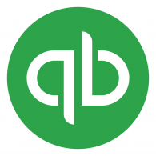

I recently had a client that wanted a primer on the quickbooks api for oauth.
Below find a short video tutorial of how to copy, configure and run a django
api that uses login with quickbooks. I also go over the oauth flow between
intuits servers and the django api endpoints.

<iframe width="560" height="315" src="https://www.youtube.com/embed/h5G_muKZwxE" frameborder="0" allow="accelerometer; autoplay; encrypted-media; gyroscope; picture-in-picture" allowfullscreen></iframe>

Overview

1. Make an intuit app
1. Clone [https://github.com/IntuitDeveloper/SampleOAuth2_UsingPythonClient](https://github.com/IntuitDeveloper/SampleOAuth2_UsingPythonClient)
1. Copy the client id and secret into settings.py
1. Copy the django callback endpoint into the intuit app
1. run the Django
1. click the sign in with quickbooks button
1. authorize your app
1. Done. Now you can perform priviledged calls from the django app against the quickbooks api

Some pitfalls

1. The oauth redirect uri needs to point to your django app. The uri quickbooks provides is useful as well and we play with it in the video.
1. The django example uses app namespaces on the urls. If you want to reverse a url by name, e.g., `` that needs to be written as ``.
