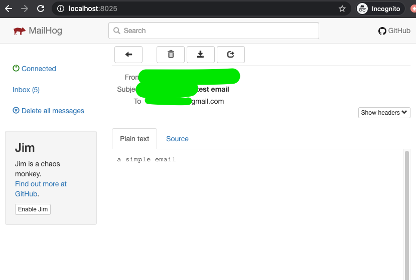

Here we share a small django management command that sends an email.
This command is useful because it will use the same email credentials the rest
of your django api is using to send emails. So you can use this as a sanity check
to see if your settings are correct.


# <your app>/management/commands/send_email.py

from django.conf import settings
from django.core.mail import send_mail
from django.core.management.base import BaseCommand

class Command(BaseCommand):
    """
    Sends an email to the provided addresses.
    """

    help = "Sends an email to the provided addresses."

    def add_arguments(self, parser):
        parser.add_argument("emails", nargs="+")

    def handle(self, *args, **options):
        self.stdout.write(f"send_email from: {settings.EMAIL_FROM_FIELD}")
        for email in options["emails"]:
            try:
                send_mail(
                    "Django test email",
                    "a simple email body",
                    settings.EMAIL_FROM_FIELD,
                    [email],
                )
            except BaseException as e:
                self.stdout.write(f"Problem sending email: {e}")


To use this ssh into your api and run:

$ python manage.py send_email foo@gmail.com bar@gmail.com


If your django api has working email smtp settings you should see a test email
at the receiving addresses.

In local development you can use something like [mailhog](https://github.com/mailhog/MailHog)
to preview the emails locally. It would look like this

