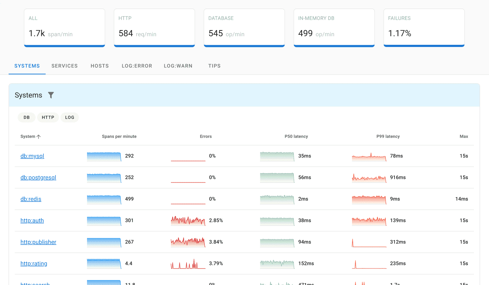
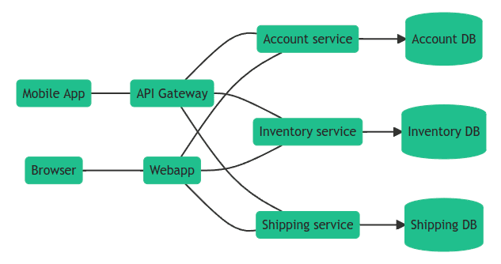
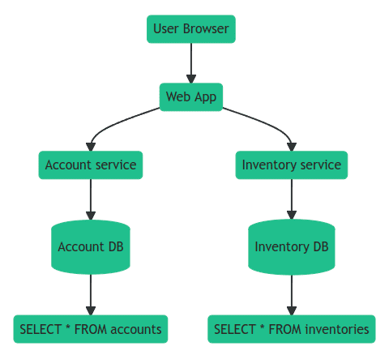

[Distributed tracing](https://opentelemetry.uptrace.dev/guide/distributed-tracing.html) allows to observe requests as they propagate through distributed systems, especially those built using a microservices architecture. In a distributed environment, tracing also helps you understand relationships and interactions between microservices. Distributed tracing gives an insight into how a particular microservice is performing and how that service affects other microservices.

Using tracing, you can break down requests into [spans](https://opentelemetry.uptrace.dev/guide/distributed-tracing.html#spans). **Span** is an operation (unit of work) your app performs handling a request, for example, a database query or a network call.

**Trace** is a tree of spans that shows the path that a request makes through an app. Root span is the first span in a trace.

To learn more about tracing, see [Distributed tracing using OpenTelemetry](https://opentelemetry.uptrace.dev/guide/distributed-tracing.html).

## What is OpenTelemetry?

[OpenTelemetry](https://opentelemetry.uptrace.dev/) is a vendor-neutral standard that allows you to collect and export [traces](https://opentelemetry.uptrace.dev/guide/distributed-tracing.html), [logs](https://opentelemetry.uptrace.dev/guide/logs.html), and [metrics](https://opentelemetry.uptrace.dev/guide/metrics.html).

OpenTelemetry is available for most programming languages and allows to send performance data to any [tracing tool](https://get.uptrace.dev/compare/distributed-tracing-tools.html) of your choice.

OpenTelemetry is a community-driven open source project that offers several components:

- **OpenTelemetry API** is a programming interface that you can use to [instrument code](https://opentelemetry.uptrace.dev/guide/distributed-tracing.html#what-to-instrument) and collect telemetry data.

- **OpenTelemetry SDK** is the official implementation of OpenTelemetry API that processes and exports collected telemetry to backends.

- [OpenTelemetry Collector](https://opentelemetry.uptrace.dev/guide/collector.html) is a proxy between your application and a backend. It receives telemetry data, transforms it, and then exports data to backends that can store it permanently. Collector can also act as an agent that pulls telemetry data from monitored systems, for example, [Redis](https://opentelemetry.uptrace.dev/collector/?receiver=redis) or filesystem metrics.

- **OTLP** is the OpenTelemetry protocol used by SDK and Collector to export data to backends or other collectors. As a transport, OTLP can use gRPC (OTLP/gRPC) or HTTP (OTLP/HTTP).

## How to use OpenTelemetry?

OpenTelemetry is available for most programming languages and provides interoperability across different languages and environments.

You can [get started with OpenTelemetry](https://opentelemetry.uptrace.dev/) by following these 5 steps:

- **Step 1**. Install a [distributed tracing tool](https://get.uptrace.dev/compare/distributed-tracing-tools.html).

- **Step 2**. Browse [OpenTelemetry instrumentations](https://opentelemetry.uptrace.dev/instrumentations/) to find examples for your framework and libraries.

- **Step 3**. [Configure](https://docs.uptrace.dev/#getting-started) OpenTelemetry SDK to export telemetry data to the tracing tool.

- **Step 4**. Learn about [OpenTelemetry Tracing API](https://opentelemetry.uptrace.dev/guide/distributed-tracing.html#what-s-next) for your programming language to create custom instrumentations.

- **Step 5**. Install [OpenTelemetry Collector](https://opentelemetry.uptrace.dev/guide/collector.html) to gather [infrastructure metrics](https://opentelemetry.uptrace.dev/guide/collector.html#host-metrics).

## OpenTelemetry Python API

You can create spans using [OpenTelemetry Python API](https://opentelemetry.uptrace.dev/guide/python-tracing.html) like this:


from opentelemetry import trace

tracer = trace.get_tracer("app_or_package_name", "1.0.0")

def insert_user(**kwargs):
    with tracer.start_as_current_span("insert-user") as span:
        return User.objects.create_user(**kwargs)


You can also record [attributes](https://opentelemetry.uptrace.dev/guide/distributed-tracing.html#attributes) and errors:


def insert_user(**kwargs):
    with tracer.start_as_current_span("insert-user") as span:
        if span.is_recording():
            span.set_attribute("enduser.id", kwargs["id"])
            span.set_attribute("enduser.email", kwargs["email"])
        return User.objects.create_user(**kwargs)


OpenTelemetry also has plans to add support for [Python Metrics](https://opentelemetry.uptrace.dev/guide/python-metrics.html) and [Python Logs](https://opentelemetry.uptrace.dev/guide/python-logs.html).

## Django OpenTelemetry instrumentation

To instrument Django, you need a correspoding [OpenTelemetry Django instrumentation](https://opentelemetry.uptrace.dev/instrumentations/python-django.html):


pip install opentelemetry-instrumentation-django


Django instrumentation uses `DJANGO_SETTINGS_MODULE` env variable to find settings file. Django defines that variable in `manage.py` file so you should instrument Django app from that file:


# manage.py

from opentelemetry.instrumentation.django import DjangoInstrumentor

def main():
    # DjangoInstrumentor uses DJANGO_SETTINGS_MODULE to instrument the project.
    # Make sure the var is available before you call the DjangoInstrumentor.
    os.environ.setdefault("DJANGO_SETTINGS_MODULE", "mysite.settings")

    DjangoInstrumentor().instrument()


For more details, see [OpenTelemetry Django guide](https://get.uptrace.dev/opentelemetry/django.html).

## What is Uptrace?

[Uptrace](https://uptrace.dev/) is an open source [DataDog competitor](https://get.uptrace.dev/compare/datadog-competitors.html) powered by OpenTelemetry and ClickHouse. It helps developers pinpoint failures and find performance bottlenecks.

Uptrace uses OpenTelemetry to collect observability data and ClickHouse database to store that data. By using an optimized [ClickHouse Go](https://clickhouse.uptrace.dev/) scheme, Uptrace allows to significantly reduce storage requirements, improve query performance, and lower monthly SaaS bills.

Uptrace itself is a single Go binary that can process billions of spans and that can be easily [installed](https://get.uptrace.dev/guide/opentelemetry-tracing-tool.html) with a single command using DEB/RPM packages. Uptrace binary and ClickHouse database is all you need to get started.

## What's next?

Next, you can continue exploring [OpenTelemetry](https://opentelemetry.uptrace.dev/) or start instrumenting your app using popular instrumentations:

- [OpenTelemetry guide for Gin and GORM](https://get.uptrace.dev/opentelemetry/gin-gorm.html)
- [gRPC OpenTelemetry](https://opentelemetry.uptrace.dev/instrumentations/go-grpc.html)
- [Golang ORM OpenTelemetry](https://bun.uptrace.dev/guide/performance-monitoring.html)
- [Go Redis OpenTelemetry](https://redis.uptrace.dev/guide/go-redis-monitoring.html)
- [Zap OpenTelemetry](https://opentelemetry.uptrace.dev/instrumentations/go-zap.html)
