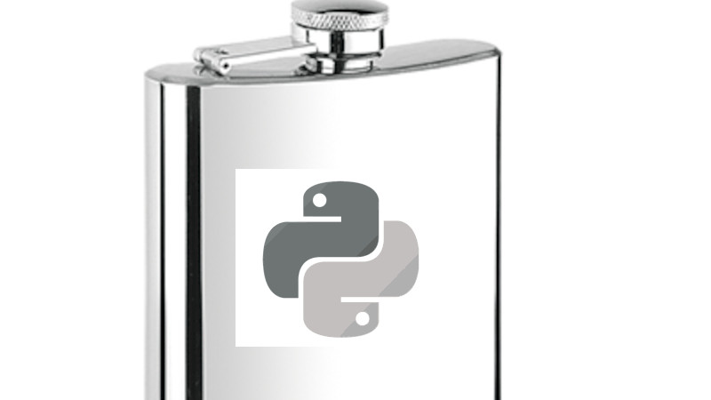

Python development is great for modern web development. There are several python based web frameworks
that can help speed up building your web app.
In this post we'll go over one popular framework, Flask, and some of the topics you
might get asked in an interview setting.

## How to prepare

Review [Flask documentation](https://devdocs.io/flask~2.2/): It's important to have a good understanding of the Flask framework and its features. Flask documentation is a great resource to learn about its capabilities, features and how to use them.

Understand Flask Architecture: Flask follows the [Model-View-Controller](https://developer.mozilla.org/en-US/docs/Glossary/MVC) (MVC) architecture. Make sure you understand the basics of the architecture and how it's implemented in Flask.

Practice Flask basics: Start practicing Flask basics such as creating [routes](https://devdocs.io/flask~2.2/api/index#flask.Flask.route), templates, views, and handling requests. Review the differences between Flask and Django and how they handle these concepts.

Review [Flask extensions](https://python.plainenglish.io/some-useful-python-flask-plugins-3ac57faaca7e): Flask has many extensions that can help you build your application more easily. Some examples of popular extensions include Flask-WTF, Flask-Login, Flask-Mail, Flask-SQLAlchemy, and Flask-RESTful. Review the extensions that you might be using and how to use them.

Prepare for database and ORM questions: Flask supports multiple ORMs, such as SQLAlchemy, Peewee, and [PonyORM](https://docs.ponyorm.org/). Prepare yourself with basic ORM concepts and review how to use Flask's most popular orm [SQLAlchemy](https://docs.sqlalchemy.org/en/20/orm/quickstart.html).

Understand Flask's security features: Flask has built-in security features, such as password hashing, CSRF protection, and [session management](https://devdocs.io/flask~2.2/api/index#flask.session). It's important to understand how these features work and how to implement them.

Build sample projects: Build some sample projects using Flask to demonstrate your understanding of the framework. You can start with a simple CRUD application and gradually move on to more complex projects like an ETL pipeline. This will help you gain more experience and confidence in working with Flask.

## Common questions

What is Flask? How is it different from other web frameworks?

What is the difference between Flask and Django?

Explain the Model-View-Controller (MVC) architecture in Flask.

What are [Flask blueprints](https://devdocs.io/flask~2.2/blueprints/index)? How do they help in structuring a large application?

How do you create a route in Flask? Explain the different types of routes in Flask.

What is Flask's template engine? How do you use it? [Jinja](https://devdocs.io/flask~2.2/templating/index)

How does Flask handle sessions? What are some [security measures](https://flask.palletsprojects.com/en/2.2.x/security/?highlight=session#set-cookie-options) Flask provides?

What is an ORM? What are some popular ORMs used in Flask?

What is [Flask-WTF](https://flask-wtf.readthedocs.io/en/1.0.x/)? How do you use it for form validation?

What are Flask extensions? Give some [examples](https://python.plainenglish.io/some-useful-python-flask-plugins-3ac57faaca7e).

What is Flask-SQLAlchemy? How do you use it?

How do you handle [authentication](https://flask-login.readthedocs.io/en/latest/) and authorization in Flask?

How do you [deploy](https://docs.docker.com/samples/flask/) a Flask application? What are some popular hosting platforms for Flask?

What are some [best practices](https://github.com/mjhea0/flaskr-tdd) for Flask development?

## Differences between Flask and Django

Complexity: Django is a full-stack web framework, which means it comes with built-in features and modules for various functionalities such as ORM, Admin Interface, Routing, Forms, Authentication, and Security. Flask, on the other hand, is a micro-framework, which means it has less built-in functionality and allows developers to add only the necessary modules and packages as per the project requirements.

Scalability: Django is well-suited for large-scale applications, and its built-in modules and features can help developers build complex applications quickly. Flask, on the other hand, is lightweight and highly customizable, making it more suitable for small to medium-sized applications that require flexibility.

Database: Django has its Object-Relational Mapping (ORM) layer, which allows developers to interact with databases using Python syntax without writing SQL queries explicitly. Flask supports various ORMs like SQLAlchemy, Peewee, PonyORM, and more.

Routing: Django has a built-in routing system that makes it easy to define URL patterns and route requests to specific views. Flask also has a routing system but allows developers to create their routing logic using decorators.

Template Engine: Django has its [built-in template engine](https://docs.djangoproject.com/en/4.1/ref/templates/language/), whereas Flask allows developers to choose their preferred template engine like Jinja2, Mako, and others.

Community: Django has a large and active community, and there are many third-party libraries and plugins available to use. Flask has a smaller community compared to Django, but it's growing steadily, and there are many useful extensions available.

In summary, Flask is a micro-framework that provides more flexibility, while Django is a full-stack framework that provides more built-in features and is more suitable for large-scale applications. You may choose Django as the main api for a platform or a Saas. Flask is a better choice to power a specific service within a microservices architecture. The choice of framework depends on the project requirements, team expertise, and development goals.
