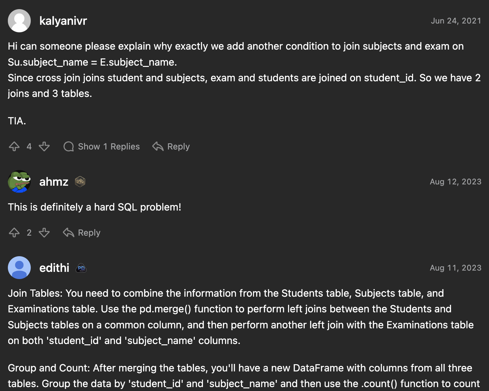
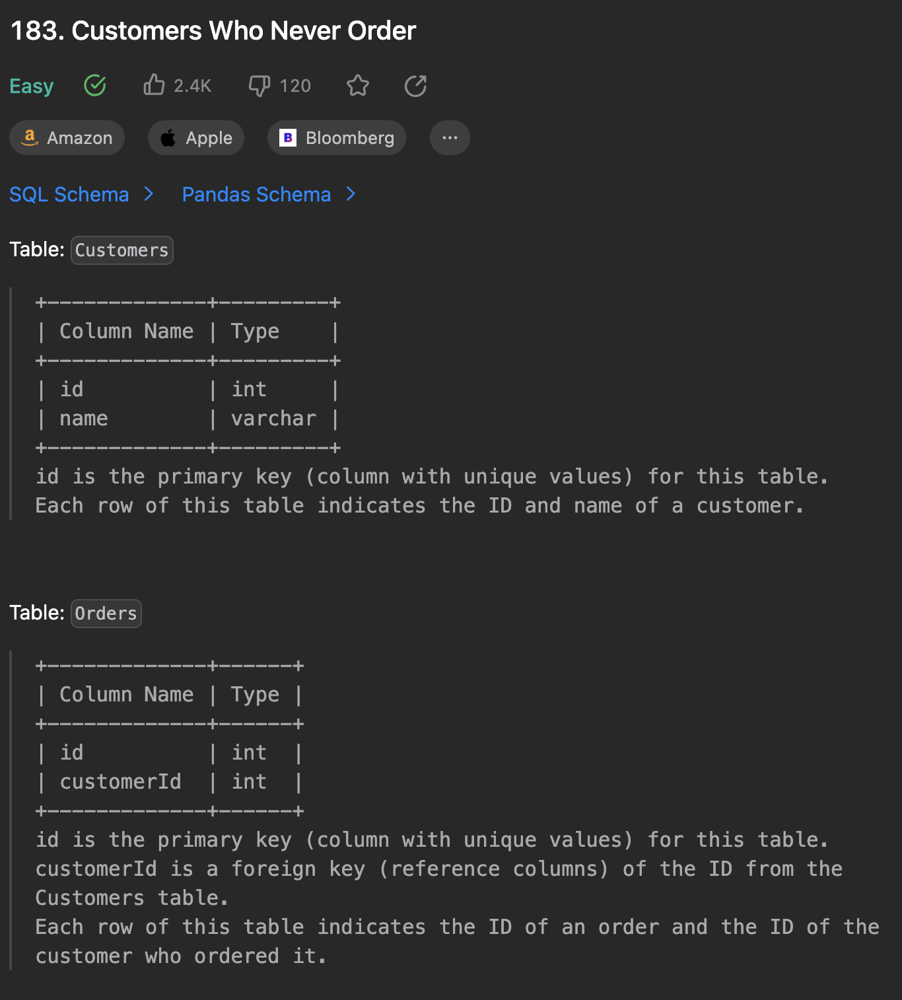
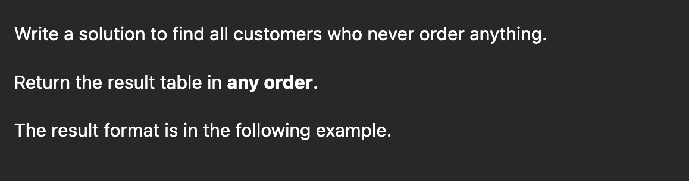
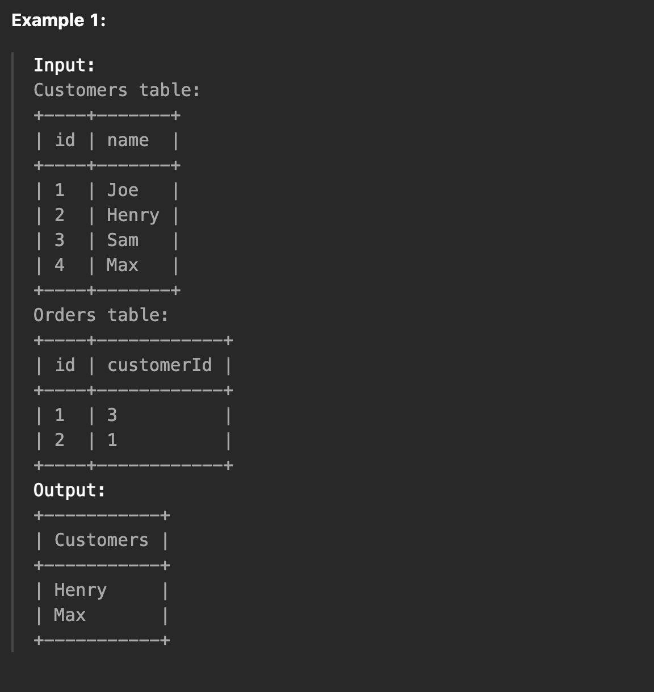
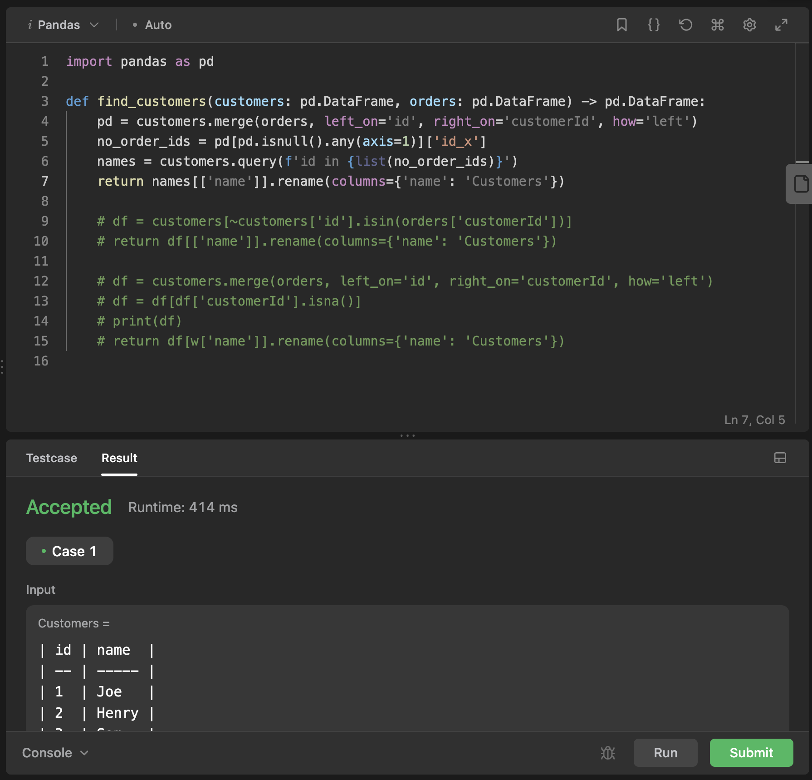

Recently I completed the Leetcode 30 day Pandas Challenge. Pandas is a popular python
library for data analysis and Leetcode has made a set of problems to learn it.
Here I share my thoughts on the problems and whether you should try it too.

Some background. Before this challenge I felt I had a good understanding of
Pandas. I understood what dataframes and Series are. How pandas builds upon
numpy datatypes. I also used pandas professionally in the past to build ETL
pipelines.

After the challenge I felt like I had a deeper understanding of pandas. I
am much more comfortable renaming columns in a dataframe, changing dataframe
datatypes, merging frames sql-style and more comfortable solving tasks I may
run into daily.

## Based on the SQL problems

The set consists of 30 problems to solve. Behind the scenes the problems are
the same as other SQL problems on the website, except you have to solve them with python and pandas. This leads to many sql comments on the problems which
can be annoying for someone trying to learn only pandas.

(SQL comments mixed with Pandas comments)

Also because the problem
statements are for sql you end up getting very comfortable with the pandas
apis. For example in many problems you have to construct the final dataframe
with specific column names


def food_delivery(delivery: pd.DataFrame) -> pd.DataFrame:
    df = delivery
    num = len(df)
    immediate = len(df[df['order_date'] == df['customer_pref_delivery_date']])
    return pd.DataFrame({'immediate_percentage': [round(immediate/num*100, 2)]})


If we were a python data analyst we wouldn't be naming columns like this very often.

## Example

One problem is called "Customers who never order" in the Data Filtering section. You first get a schema describing the data

Then you get a task, here it asks to find all customers who never order anything

Then you get some example results when they run your solution on different data

Then you are to write your solution in the editor

The editor is in pandas mode. It is the same throughout the website for
java questions, javascript question, ruby, etc. You write your solution and can
try it on the tests by clicking Run. When you are happy with the solution you
can submit and Leetcode will run your solution on a larger test suite serverside.

### My Solution
My solution to this problem is


def find_customers(customers: pd.DataFrame, orders: pd.DataFrame) -> pd.DataFrame:
    pd = customers.merge(orders, left_on='id', right_on='customerId', how='left')
    no_order_ids = pd[pd.isnull().any(axis=1)]['id_x']
    names = customers.query(f'id in {list(no_order_ids)}')
    return names[['name']].rename(columns={'name': 'Customers'})


First I merge the `customer` and `orders` table on the ids


pd = customers.merge(orders, left_on='id', right_on='customerId', how='left')


Then I get all ids for the customers that made no orders with `.isnull()`


no_order_ids = pd[pd.isnull().any(axis=1)]['id_x']


Then we use `.query()` to get all the customers in the original dataframe that
we know have no orders (are in the no_order_ids series)


names = customers.query(f'id in {list(no_order_ids)}')


Finally we narrow down the original `names` dataframe to get the customer's name
and rename the column to fit the problem requirements.


return names[['name']].rename(columns={'name': 'Customers'})


By the way, there is more than one way to solve each problem. You are allowed
to use the full expressivity of python and the pandas apis.

## Topics

The 30 pandas questions are split into 6 section.
1. Data Filtering
1. String Methods
1. Data Manipulation
1. Statistics
1. Data Aggregation
1. Data Integration

In the following sections we list the pandas apis we used to solve the problems.

### Data Filtering
* [Boolean Indexing](https://pandas.pydata.org/docs/user_guide/10min.html#boolean-indexing)
* [.query() method](https://pandas.pydata.org/docs/user_guide/indexing.html?highlight=query#the-query-method)

### String Methods
* Series.str Family of methods [https://github.com/pandas-dev/pandas/blob/v2.0.3/pandas/core/strings/accessor.py#L2962](https://github.com/pandas-dev/pandas/blob/v2.0.3/pandas/core/strings/accessor.py#L2962)
* Adding columns with [numpy.where](https://devdocs.io/numpy~1.23/reference/generated/numpy.where)
* Regex with Series.str.contains() and Series.str.match()

### Data Manipulation
* DataFrames's [head() and tail()](https://pandas.pydata.org/docs/user_guide/basics.html#head-and-tail)
* Numbering rows with [rank() https://devdocs.io/pandas~1/reference/api/pandas.dataframe.rank](https://devdocs.io/pandas~1/reference/api/pandas.dataframe.rank)
* Reshaping and pivot tables with [melt()](https://pandas.pydata.org/docs/user_guide/reshaping.html?highlight=melt#reshaping-by-melt)
* deduplicating with [drop_duplicates()](https://pandas.pydata.org/docs/user_guide/indexing.html?highlight=drop_duplicates#duplicate-data)

### Statistics
* constructing dataframes with [pd.Dataframe()]()
* Quantizing with [pd.cut()](https://pandas.pydata.org/docs/user_guide/basics.html?highlight=cut#discretization-and-quantiling)

### Data Aggregation
* Aggregations with [groupby()]()
* [Named Aggregations](https://pandas.pydata.org/docs/user_guide/groupby.html?highlight=namedagg#named-aggregation) with lambdas
* Adding new columns with [assign()](https://pandas.pydata.org/docs/user_guide/dsintro.html?highlight=assign#assigning-new-columns-in-method-chains)

### Data Integration
* Promoting a group's index to a column with [reset_index()](https://pandas.pydata.org/docs/getting_started/intro_tutorials/07_reshape_table_layout.html?highlight=reset_index#wide-to-long-format)
* sql-style-join with [merge()](https://pandas.pydata.org/docs/user_guide/merging.html#database-style-dataframe-or-named-series-joining-merging)
* testing membership with [Series.isin()](https://pandas.pydata.org/docs/user_guide/indexing.html?highlight=isin#indexing-with-isin)
* [Negating .isin() with the unary not ~](https://pandas.pydata.org/docs/user_guide/indexing.html?highlight=isin#boolean-operators)

## Conclusion

Overall I would recommend doing this challenge. The questions seem realistic to
the tasks a data analyst may encounter in everyday work. The questions force
you to use a large amount of the pandas api. The problems are rated as "beginner"
pandas difficulty. You could complement this challenge with some Kaggle
competitions so you could apply your pandas knowledge.