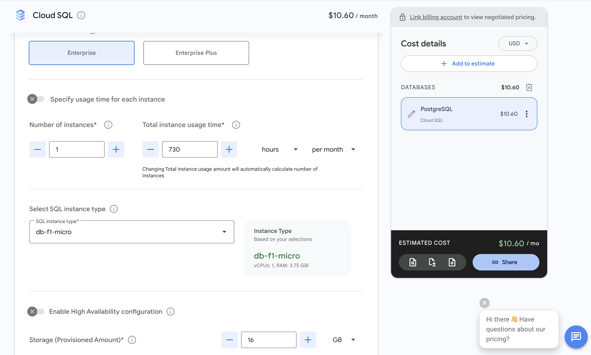
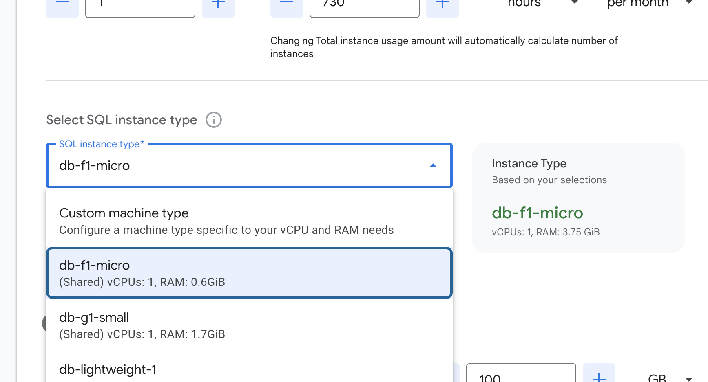
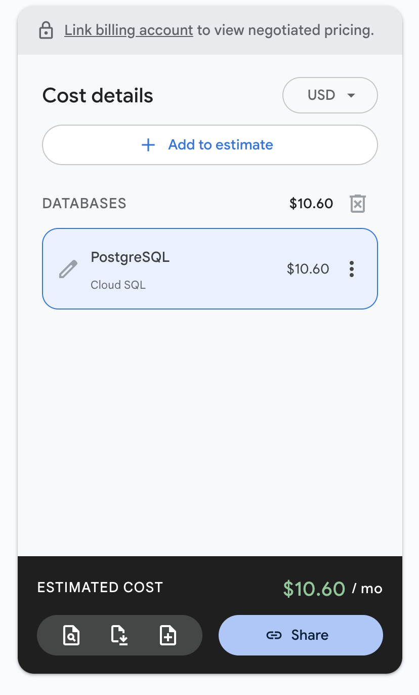

Here is the command for provisioning the cheapest database on Google Cloud SQL. There were a couple of pitfalls as I'll explain.


gcloud sql instances create myinstance \
  --project my-project \
  --database-version POSTGRES_16 \
  --tier db-f1-micro \
  --region your-region \
  --edition=ENTERPRISE


Notes:

By default you may be instructed in the code labs to run


gcloud sql instances create myinstance --project $PROJECT_ID \
  --database-version POSTGRES_14 --tier db-f1-micro --region $REGION


You can change the postgres engine version to something modern like `POSTGRES_16`. The versions are listed [here](https://cloud.google.com/sql/docs/postgres/db-versions). As of this writing postgresql 16.3 is the default version.

When you run


gcloud sql instances create myinstance \
  --project $PROJECT_ID \
  --database-version POSTGRES_16 \
  --tier db-f1-micro \
  --region $REGION


you get the error


ERROR: (gcloud.sql.instances.create) HTTPError 400: Invalid request:
Invalid Tier (db-f1-micro) for (ENTERPRISE_PLUS) Edition.
Use a predefined Tier like db-perf-optimized-N-* instead.
Learn more at https://cloud.google.com/sql/docs/postgres/create-instance#machine-types.


You can bypass this by specifying a lower tier for edition


gcloud sql instances create myinstance \
  a--project $PROJECT_ID \
  --database-version POSTGRES_16 \
  --tier db-f1-micro \
  --region $REGION \
  --edition=ENTERPRISE


In the pricing calculator you can get the cost of the database down to [$10.60 per month](https://cloud.google.com/products/calculator/?hl=en&dl=CjhDaVEzTm1GaE56WmxNaTFoTURVeUxUUXhZekV0WVdWaVpTMDFZek00TWpCbE5UQTJORElRQVE9PRAHGiRFNDlBQzE5NC04REM1LTRBQ0YtQkY5QS04RTBGQzAwRTZEQUQ). I did this by choosing a shared vcpu database

and lowering the disk size to 16gb.

