

  <i class="fa fa-handshake"></i>
   
  <h1>Hire Me</h1>

  

  My work may not always be visible. Sometimes it's behind the scenes powering
  recommendation systems, letting you know your systems are down before your
  customers
  do or making sure different departments of your business get the insights
  they need to make decisions.
  

## Work

  

    <h3>Getaway</h3>

    I helped <a href="https://getaway.house">Getaway</a> develop an internal employee webportal. This portal
    allowed getaway employees to peform their daily tasks. This is a common requirement in growing
    startups, that they need to build their own tooling to graduate off spreadsheets and adhoc
    processes.

    <a href="https://getaway.house">
      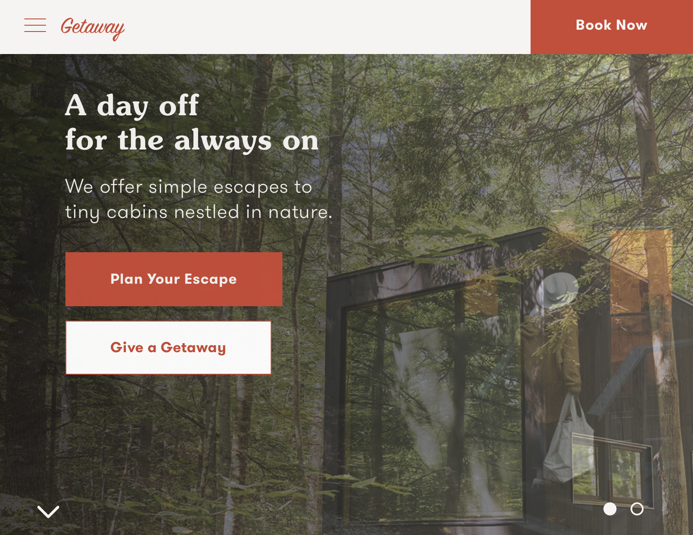
    </a>
  

  

    <h3>Free Code Camp</h3>

    <a href="https://www.freecodecamp.org">
      Free Code Camp
    </a>
    is one of the largest open source projects and coding schools in the world.
    During my time in San Francisco I met Quincy Larson and helped develop the
    mvp for FCC in Ruby on Rails. I also advised on the migration from RoR to
    Node.js and MongoDB.

    <a href="https://freecodecamp.com" target="_blank">
      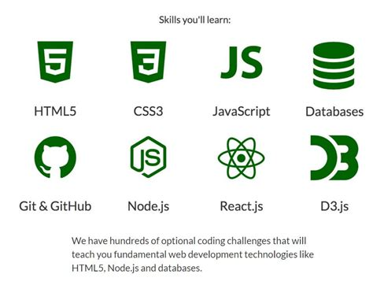
    </a>
  

  

    <h3>Capsule Pharmacy</h3>

    I helped start <a href="https://www.capsulecares.com">Capsule Pharmacy</a> as the fifth engineer. I helped grow the
    business from 50 beta users, through launch, through series A fundraising, through +20,000 monthly
    active users. We built the consumer facing page with e-commerce flow, the internal corporate CMS
    where 30+ persons performed 40+ hours of work per week, built a go api, built a django api, wrote
    documentation for all code and processes/procedures, performed on-call duties (devops), wrote
    sql reports for stakeholders and onboarded fellow engineers.

    <a href="https://itunes.apple.com/us/app/capsule-pharmacy/id1092333652">
      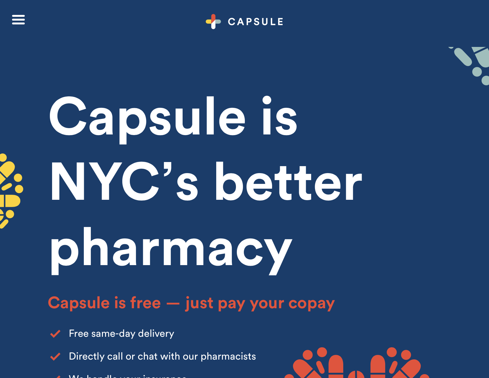
    </a>
    
    

      <iframe
        width="560"
        height="315"
        src="https://www.youtube.com/embed/VBuBTr5YR74"
        frameborder="0"
        allow="accelerometer; autoplay; encrypted-media; gyroscope; picture-in-picture" allowfullscreen></iframe>
    

  

  

    <h3>SK-II Japan store</h3>

    I made the websites running in the video below. One powering 10 42" vertically mounted touchscreens. The second
    website powering 5 vanity tables where customers could try out the skincare products.
    I worked closely with world-class designers
    that would deliver pictures and video of the desired effects.
    The client was <a href="https://www.sk-ii.com/">SK-II Japan</a> subsidiary of proctor & gamble.

    
    
    

      <iframe
        width="560"
        height="315"
        src="https://www.youtube.com/embed/eh8DSsbXlzU?start=158"
        frameborder="0"
        allow="accelerometer; autoplay; encrypted-media; gyroscope; picture-in-picture"
        allowfullscreen>
      </iframe>
    

  

  

    <h3>Litt</h3>

    <a href="https://getlitt.app">
      Litt
    </a>
    is a social mobile app. It is designed to connect you with people in your
    neighborhood through events and profiles. It also has a b2b component where
    local businesses can pay to promote their events in the local feed.

    <a href="https://getlitt.app" target="_blank">
      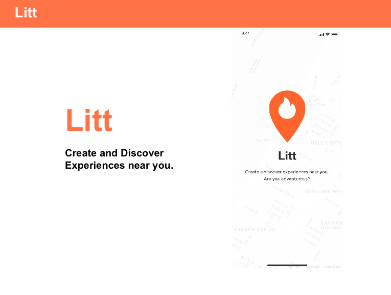
    </a>
    
    
  

  

    <h3>Hedgefund</h3>

    I helped a Hedgefund develop an internal scheduling tool. They needed an
    application for coordinating meetings and producing an audit trail. I used
    agile methodology to translate requirements into tasks with story points,
    delegated work to other engineers as tech lead and conducted customer
    facing meetings. Stack was Django, Docker, jQuery and Datatables.

    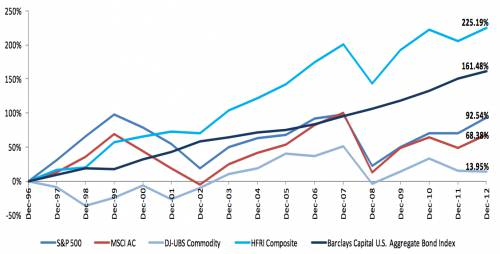
  

## Open Source

  

    <h3>React Native Contacts</h3>

    <a href="https://github.com/rt2zz/react-native-contacts">react-native-contacts</a> was the first api bridge
    for React Native that allowed you to load the phone's contacts. Oddly enough facebook chose
    not to bridge this api and when I realized this I solved
    the problem and open sourced it. I still maintain the module and it's been interesting
    seeing how react native has evolved over the years. It is written in Java and Objective-c.

    
    

      
      
    

  

  

    <h3>AutoViML</h3>

    <a href="https://github.com/AutoViML">AutoViML</a> automates most of the
    mundane tasks for a data scientist regarding model selection and building
    plots. I advise the author Ram Seshadri on best software engineering
    practices when it comes to python libraries. And he helps me when I am
    stuck on hard datascience problems.

    
    

      
      
    

  

  

    <h3>Fullstack Apollo GraphQL React Native Boilerplate</h3>

    The
    <a href="https://github.com/morenoh149/fullstack-apollo-react-native-boilerplate">Fullstack Apollo GraphQL React Native Boilerplate</a>
    is a starter project part of the
    <a href="https://github.com/the-road-to-graphql/fullstack-apollo-express-postgresql-boilerplate">
      fullstack family
    </a>
    of starter projects. When you run this boilerplate and a corresponding backend
    you have a fully functioning react native app with user
    authentication using GraphQL.

    <a href="https://github.com/morenoh149/fullstack-apollo-react-native-boilerplate">
      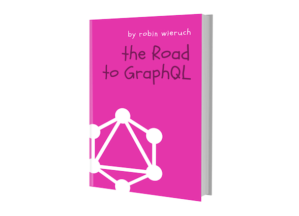
    </a>
    

      
      
    

  

## Technologies I know

  

    Facebook Login
    
  

  

    ReactJS WebApps
    
  

  

    React Native Apps
    
  

  

    Android Apps
    
  

  

    iOS Apps
    
  

  

    Stripe Credit Card processing
    
  

  

    Payeezy
    
  

  

    Heroku Cloud
    
  

  

    Amazon Web Services
    
  

  

    Google Cloud Platform
    
  

  

    Cascading Style Sheets
    
  

  

    Django Webframework
    
  

  

    Ruby on Rails
    
  

  

    NodeJS
    
  

  

    Postgres
    
  

  

    MySql
    
  

  

    Tensorflow
    
  

  

    Javascript
    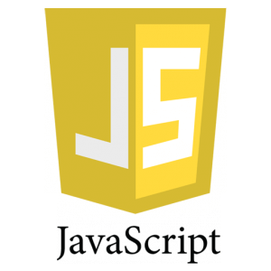
  

  

    Python
    
  

  

    Java
    
  

  

    Go Language
    
  

  

    SQL - Structured Query Language
    
  

  

    Segment - Conversion Funnels
    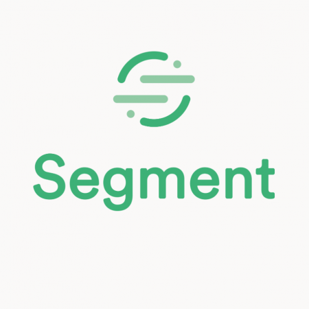
  

  

    Twilio - SMS text
    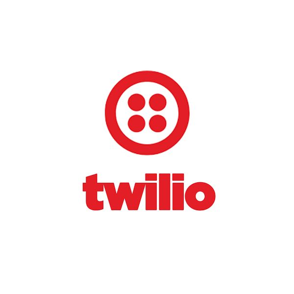
  

  

    Health Information Privacy and Portability Act Compliance
    
  

  

    SSL - Secure Sockets Layer
    
  

  

    Amazon RDS
    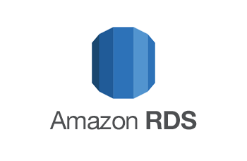
  

  

    Amazon Redshift
    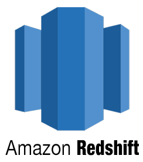
  

  

    Google BigQuery
    
  

  

    Amazon S3 - cloud storage
    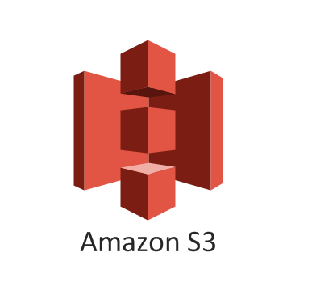
  

  

    Amazon EC2 - Elastic Compute Cloud
    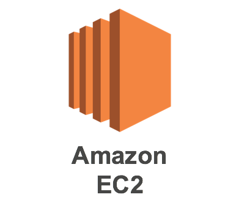
  

  

    Elasticsearch
    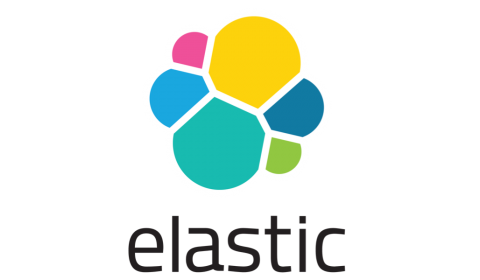
  

  

    Amazon Alexa Skills
    
  

  

    Facebook GraphQL
    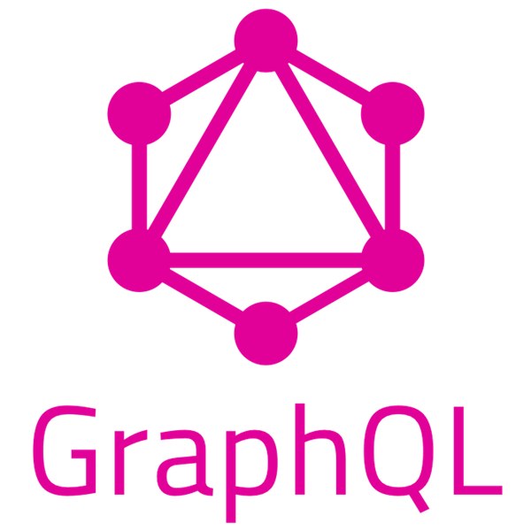
  

  

    Scrapy web scraping
    
  

  

    Clover Point of Sale
    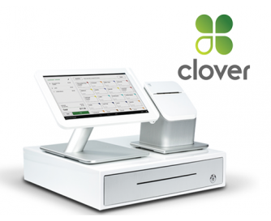
  

  

    Expo phone apps
    
  

  

    Datatables js
    
  

<h2 id="my-process">Who I am</h2>
I am Harry Moreno a software developer living in New York City. Born and raised
in The Bronx, I've lived in Massachusetts and San Francisco. I now call Brooklyn
my home. Since 2013 I've worked with a wide range of companies, from
startups to world renowned marketing agencies. My focus is on delivering
flexible reliable software that is useful to people and improves their lives.

  <iframe
    width="560"
    height="315"
    src="https://www.youtube-nocookie.com/embed/UlmZ5H-UK0c"
    frameborder="0"
    allow="accelerometer; autoplay; encrypted-media; gyroscope; picture-in-picture" allowfullscreen></iframe>

  <h2>What I do</h2>

  My experience is in growing small software companies into larger software
  companies.
  I specialize in solving unique problems with custom software. Whether that's
  a phone app, headless cloud software or a website.

  In general I prefer working on new projects where I can sit down with you and
  elicit all the software requirements. This gives me the flexibility to
  work with the best tools for the job.

  I've done Fullstack software engineering, in Python, Go and Javascript.
  I like SQL, Deep Learning and launching products.

  <h2>My Process</h2>
  <ol>
    <li>
    <strong>Elicit requirements</strong>.
    I sit down with you (over the phone or coffee).
    We discuss your needs and I write down notes.
    </li>
    <li>
    <strong>Estimate</strong>.
    After eliciting requirements I sit down on my own and break down the product
    requirements into small technical tasks with a time estimate. I get back to you with
    a detailed project proposal on how to achieve the business goals,
    estimated cost and a timeline for the project.
    </li>
    <li>
    <strong>Build</strong>.
    If the timeline and cost are acceptable to us we begin the
    project. I usually require a portion of the budget at the beginning,
    after major milestones and at the end.
    </li>
  </ol>

  <h2>What I charge</h2>
  I generally work on an daily rate. For clients that prefer a flat-fee we can
  discuss that on a case by case basis.

