My work may not always be visible. Sometimes it's behind the scenes powering
recommendation systems, letting you know your systems are down before your
customers
do or making sure different departments of your business get the insights
they need to make decisions.

Some projects that you _can_ see:
# Chronic Sickness

[chronicsickness.com](https://chronicsickness.com) is a Classification Model using Deep Learning. Specifically using tensorflow,
transfer learning with the imagenet weights, AWS Sagemaker, Scrapy for scraping the images
off forums, Flask and EC2. I presented the beta at defcon 2018.

  <a href="https://chronicsickness.com">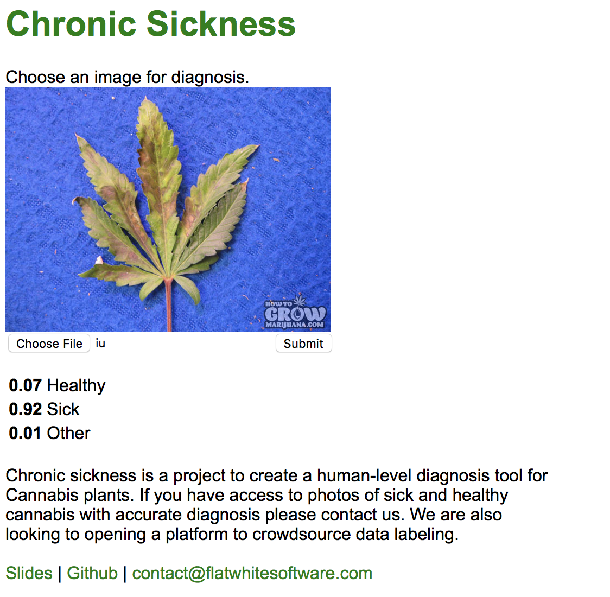</a>
  <a href="https://chronicsickness.com">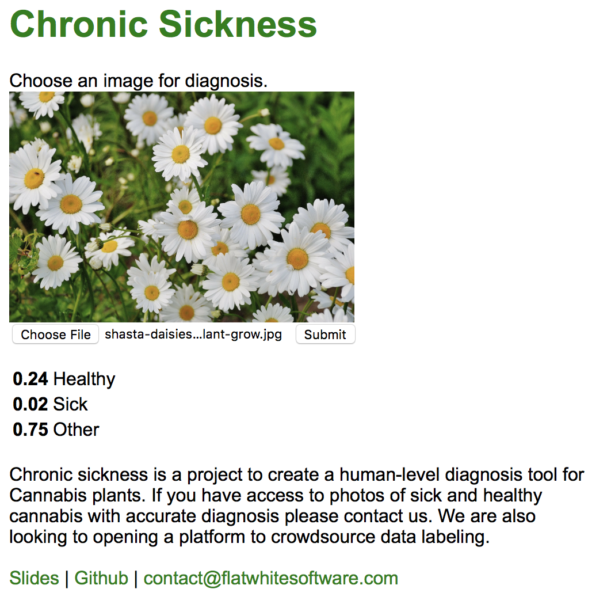</a>

<iframe width="560" height="315" src="https://www.youtube.com/embed/CsRYAUlb6_E" frameborder="0" allow="accelerometer; autoplay; encrypted-media; gyroscope; picture-in-picture" allowfullscreen></iframe>

# Smart store

SK-II Japan, an Asian skincare brand and subsidiary of Proctor & Gamble, wanted to open
a popup shop in Kobe, Japan - a trendy part of the country. I worked on developing
two web applications. One powering 10 42" vertically mounted touchscreens. The second
website powering 5 vanity tables where customers could try out the skincare products.
I worked closely with world-class designers
that would deliver pictures and video of the desired effects.

  
  

<iframe width="560" height="315" src="https://www.youtube.com/embed/eh8DSsbXlzU?start=158" frameborder="0" allow="accelerometer; autoplay; encrypted-media; gyroscope; picture-in-picture" allowfullscreen></iframe>

# Getaway

I helped [Getaway](https://getaway.house) develop an internal employee webportal. This portal
allowed getaway employees to peform their daily tasks. This is a common requirement in growing
startups, that they need to build their own tooling to graduate off spreadsheets and adhoc
processes.

<a href="https://getaway.house">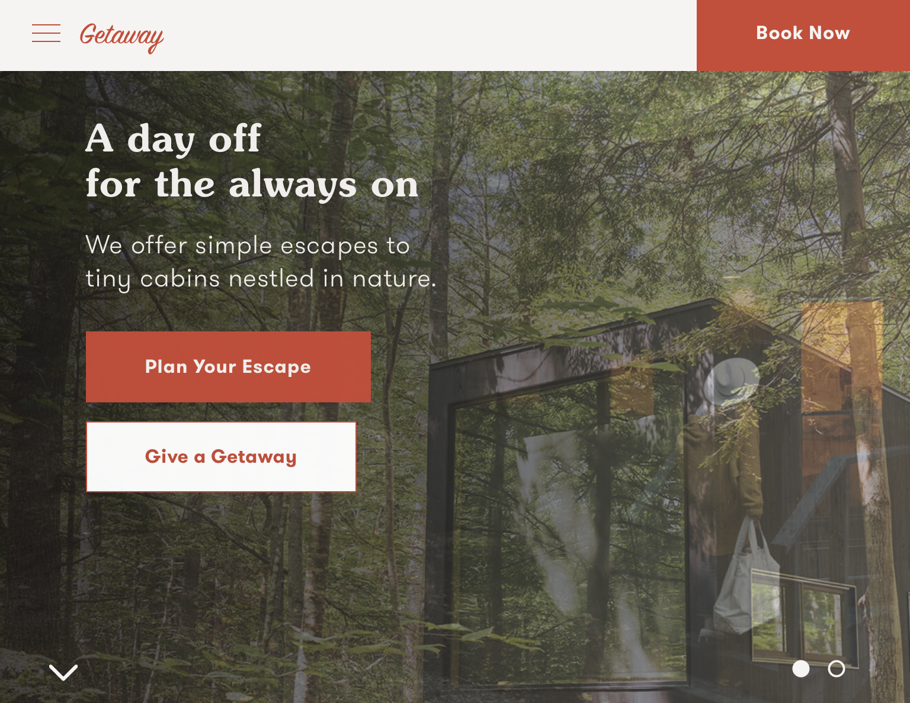</a>

# Capsule Pharmacy

I helped start [Capsule Pharmacy](https://getaway.house) as the fifth engineer. I helped grow the
business from 50 beta users, through launch, through series A fundraising, through +20,000 monthly
active users. We built the consumer facing page with e-commerce flow, the internal corporate CMS
where 30+ persons performed 40+ hours of work per week, built a go api, built a django api, wrote
documentation for all code and processes/procedures, performed on-call duties (devops), wrote
sql reports for stakeholders and onboarded fellow engineers.

  
  <a href="https://itunes.apple.com/us/app/capsule-pharmacy/id1092333652">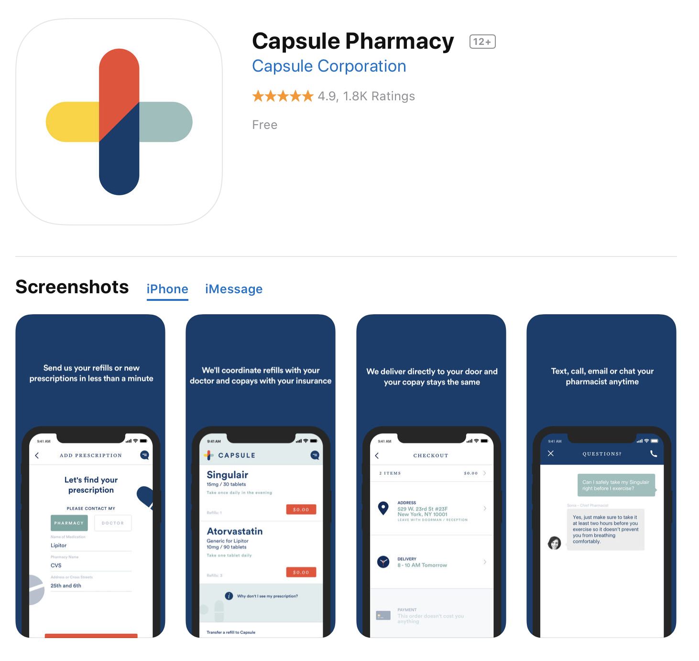</a>

# React Native Contacts

[react-native-contacts](https://github.com/rt2zz/react-native-contacts) was the first api bridge
for React Native that allowed you to load the phone's contacts. Oddly enough facebook chose
not to bridge this api and when I realized this for an app I was developing I solved
the problem and open sourced it. I still maintain the module and it's been interesting
seeing how react native has evolved over the years. It is written in Java and Objective-c.

  
  

## Technologies I know

  
  
  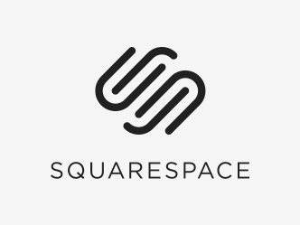
  
  
  
  
  
  
  
  
  
  
  
  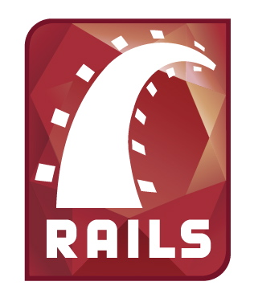
  
  
  
  
  
  
  
  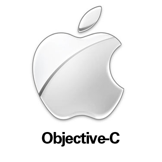
  
  
  
  
  
  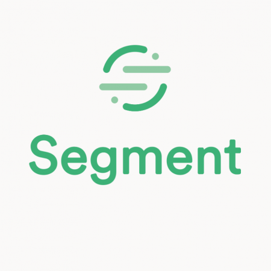
  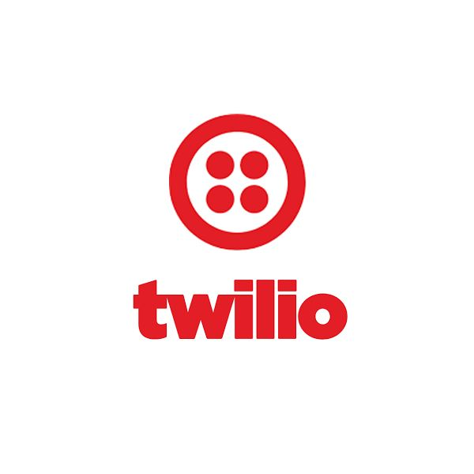
  
  
  
  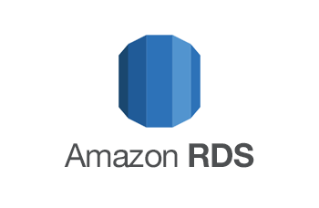
  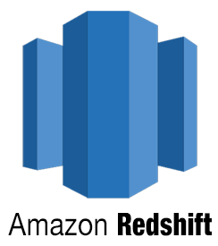
  
  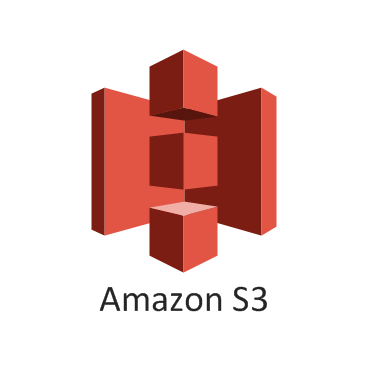
  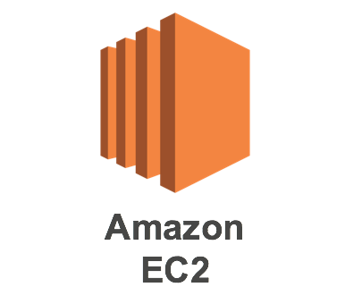
  
  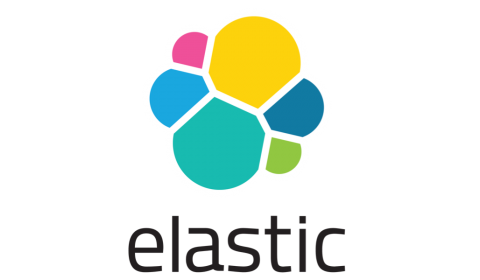
  
  
  
  
  
  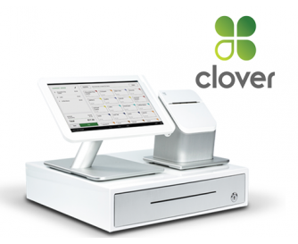

If you want me to build you something
contact me below. If you're curious about how I work and what my process is
read how to [hire me](/hire-me.html).
